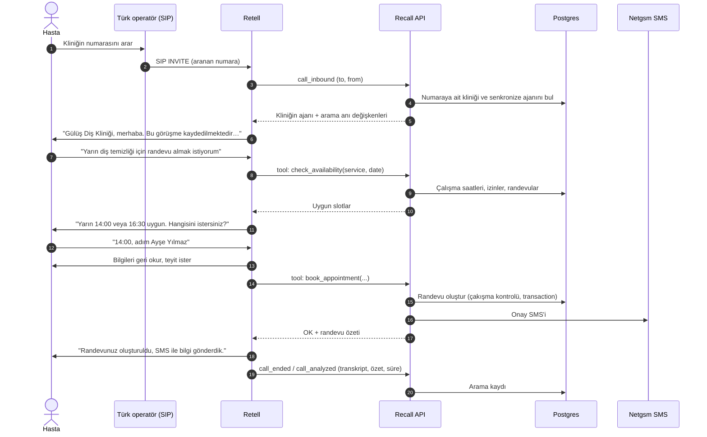

# Kullanıcı Akışları

## 1. Gelen arama: yeni randevu (ana akış)

**Adımlar ve kurallar**

1. **Karşılama:** Klinik adı, kayıt ve aydınlatma anonsu (KVKK), "Size nasıl yardımcı olabilirim?"
2. **Niyet tespiti:** Yeni randevu, iptal, erteleme, bilgi veya diğer.
3. **Hizmet tespiti:** Hasta hizmeti belirtmezse kısa bir soru sorulur ("Muayene mi, temizlik mi?"). Bilinmiyorsa varsayılan hizmet "Muayene / Kontrol" olur.
4. **Hekim tercihi:** Opsiyoneldir. Tercih yoksa en erken uygun hekim seçilir.
5. **Tarih/saat:** "Yarın", "haftaya salı", "öğleden sonra" gibi ifadeler kliniğin saat dilimine göre çözülür. En fazla 2–3 seçenek sunulur.
6. **Kimlik:** Arayan numara (caller ID) ile hasta aranır. Kayıt yoksa ad soyad sorulur. Numara gizliyse telefon numarası istenir.
7. **Teyit:** Hizmet, hekim, gün, saat ve isim geri okunur. Hasta onaylamadan kayıt yapılmaz.
8. **Kayıt:** `book_appointment`. Slot bu arada dolduysa yeni seçenek sunulur.
9. **Kapanış:** SMS bilgisi, "Başka bir konuda yardımcı olabilir miyim?"

## 2. Randevu iptali

1. Arayan numara ile hastanın **gelecekteki** randevuları bulunur (`find_appointments`).
2. Birden fazla randevu varsa hangisi olduğu sorulur.
3. Teyit alınır ve `cancel_appointment` çağrılır. İptal SMS'i gönderilir.
4. Asistan yeniden randevu teklif eder: "Başka bir güne almak ister misiniz?"
5. Kliniğin iptal kuralı varsa (ör. "24 saatten az kala iptal edilemez") asistan bunu iletir ve isteği geri arama notu olarak bırakır.

## 3. Randevu erteleme

İptal ve yeni randevu akışlarının birleşimidir, ancak atomik çalışır: `reschedule_appointment` yeni slotu ayırmadan eski randevuyu iptal etmez.

## 4. Bilgi talebi

Adres, çalışma saatleri, hizmetler, (izin varsa) fiyat aralığı, otopark, ödeme seçenekleri. Kaynak: kliniğin config'indeki `faq` ve `services` alanları. Asistan bilmediği bir şeyi **uydurmaz**: "Bu konuda net bilgi veremiyorum, sizi arkadaşıma aktarabilirim veya not bırakabilirim."

## 5. İnsana devretme / geri arama

- **Mesai içi ve devir numarası tanımlı:** Arama kliniğin devir numarasına aktarılır (`transfer_call`).
- **Mesai dışı veya devir başarısız:** Geri arama notu oluşturulur (`create_callback_request`) ve panelde "Geri aranacaklar" listesine düşer.
- Ayrıntılar: [ESCALATION.md](../02-voice-agent/ESCALATION.md)

## 6. Panel: sekreterin günü

1. Giriş yapar; **Bugün** ekranı açılır (günün randevuları, yeni gelenler, geri aranacaklar).
2. Asistanın aldığı yeni randevuları "Yeni" etiketiyle görür ve arama özetine tıklayarak kontrol eder.
3. Geri arama listesindeki hastaları arar ve "Tamamlandı" olarak işaretler.
4. Kapıdan gelen hasta için panelden manuel randevu oluşturur (kaynak: `panel`).
5. Gün sonunda gelmeyen hastaları "Gelmedi" olarak işaretler.

## 7. Onboarding

Bkz. [ONBOARDING.md](../04-panel/ONBOARDING.md)
