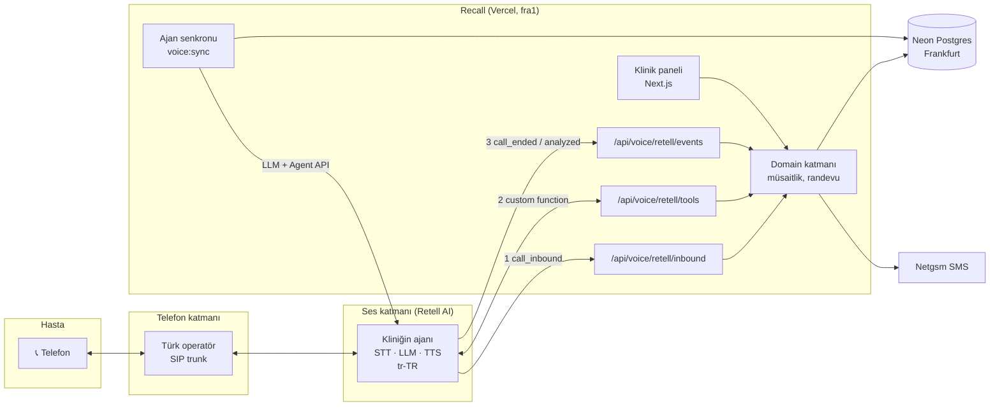

# Mimari

## Genel bakış



## Neden bu mimari?

**Gerçek zamanlı ses işleme Vercel'de çalışmaz.** Bir telefon görüşmesi dakikalarca açık kalan, çift yönlü ve düşük gecikmeli bir ses akışıdır. Vercel Functions ise istek-yanıt modeline göre çalışır. Bu yüzden sorumluluğu ikiye ayırıyoruz:

| Katman          | Sorumluluk                                                           | Nerede                       |
| --------------- | -------------------------------------------------------------------- | ---------------------------- |
| **Ses katmanı** | SIP, STT, LLM döngüsü, TTS, söz kesme (barge-in), sessizlik algılama | Retell AI (yönetilen servis) |
| **İş katmanı**  | Klinik verisi, müsaitlik, randevu, hasta, arama kaydı, panel         | Recall / Vercel              |

Karar: [ADR-004](../decisions/ADR-004-retell-voice-platform.md).

## Çok kiracılı ses: klinik başına senkronize ajan

**Tek kod tabanı, sınırsız klinik.** Her kliniğin Retell'de kendi **LLM**'i ve **ajanı** vardır. Bunlar elle değil, bizim veritabanımızdan üretilir:

1. **Senkron (`pnpm voice:sync`, F5'te panelden otomatik):** Klinik verisi (hizmetler, hekimler, saatler, SSS, ses, kurallar) → [`buildRetellAgentSpec`](../../src/server/voice/providers/retell/agent-spec.ts) → Retell LLM + Agent oluştur/güncelle → `voice_agents` tablosuna `external_agent_id`, `agent_version`, `spec_hash` yazılır. Spec değişmediyse Retell çağrılmaz.
2. **Arama anı:** Prompt sabittir. Değişen değerler değişkenlerle gelir:
   - Retell'in yerleşik değişkenleri: `{{current_time_Europe/Istanbul}}`, `{{current_calendar_Europe/Istanbul}}`; arayan numara bizim `{{caller_number}}` değişkenimiz (inbound webhook doldurur, web aramalarında boş)
   - Bizim değişkenlerimiz (inbound webhook ile): `{{transfer_available}}`, `{{clinic_status}}`

Retell panelinde ajan elle düzenlenmez; bir sonraki senkron değişiklikleri ezer.

## Bileşenler

### Next.js uygulaması (`src/app`)

- **`(marketing)`:** Herkese açık tanıtım sayfası.
- **`panel/`:** Oturum gerektiren klinik paneli (F5).
- **`api/voice/retell/inbound`:** Gelen arama webhook'u. Numara → klinik → ajan ve değişkenler.
- **`api/voice/retell/tools`:** Retell custom function'ları. `name` alanına göre tool çalıştırır.
- **`api/voice/retell/events`:** `call_started`, `call_ended`, `call_analyzed`.
- **`api/cron/*`:** Vercel Cron job'ları (F2, F7).
- **`api/health`:** Uptime izleme.

### Sunucu katmanı (`src/server`)

- **`db/`:** Drizzle şeması, client, seed.
- **`domain/`:** Framework'ten bağımsız iş kuralları. Müsaitlik hesabı saf fonksiyondur ve DB'ye dokunmaz.
- **`voice/`:**
  - `tools/`: Tool tanımları (Zod şema ve handler). Sağlayıcıdan bağımsızdır.
  - `prompt.ts`: Klinik verisinden prompt şablonu üretir. Arama anı değerleri yer tutucudur.
  - `providers/retell/`: Retell'e özgü her şey: `agent-spec.ts` (spec üretimi), `sync.ts` (senkron), `handlers.ts` (webhook'lar), `schemas.ts`, `config.ts`, `deps.ts`.
- **`notifications/`:** SMS gönderimi (Netgsm adaptörü, lokalde konsol adaptörü).

### Veri

- **Postgres:** Tek veritabanı, satır seviyesinde kiracı izolasyonu (`clinic_id`). Bkz. [MULTI-TENANCY.md](MULTI-TENANCY.md).
- **`voice_agents`:** Kliniğin Retell ajanı ile bağlantısı. **`phone_numbers`:** Kliniğin gelen arama numaraları.
- **Ses kayıtları:** Retell'de tutulur; biz sadece URL saklarız. Saklama: [DATA-RETENTION.md](../05-compliance/DATA-RETENTION.md).

## İstek akışları

### Gelen arama

```
Retell ── POST /api/voice/retell/inbound ──▶ Recall
  1. X-Retell-Signature doğrula (ham gövde, API anahtarı, 5 dk pencere)
  2. call_inbound.to_number → E.164 → phone_numbers → klinik
  3. voice_agents → override_agent_id + override_agent_version
  4. calls satırı aç (call_id)
  5. ◀── { call_inbound: { override_agent_id, override_agent_version,
                            dynamic_variables: { transfer_available, clinic_status },
                            metadata: { clinic_id } } }
     Numara bilinmiyor veya ajan senkronize değil → { call_inbound: { reject: true } }
```

### Tool çağrısı

```
Retell ── POST /api/voice/retell/tools { name, args, call } ──▶ Recall
  1. İmza doğrula
  2. call.agent_id → voice_agents → klinik
     call.metadata.clinic_id varsa ikisi eşleşmeli (yoksa 404)
  3. calls satırını bul/oluştur
  4. runTool(name, args, { clinic, callerPhone: call.from_number, … })
  5. ◀── { ok: true, … } | { ok: false, error, message }
```

Tool handler'ları **her zaman** sunucuda çözümlenen klinik ile çalışır. LLM'in ürettiği argümanlar asla kiracı belirlemez.

### Arama olayları

`call_ended` ve `call_analyzed` olayları süre, bitiş nedeni, transkript, kayıt URL'i, özet ve maliyeti (cent → USD) yazar. Olaylar tekrar gelebilir; yalnızca gelen alanlar yazılır, sonuç (`outcome`) öncelik sırasıyla korunur (bir randevu "bilgi" ile ezilmez).

## Gecikme bütçesi

Hedef: hasta konuşmayı bitirdikten sonra ilk sese kadar p50 < 1,0 sn.

| Aşama                               | Bütçe      |
| ----------------------------------- | ---------- |
| Konuşma sonu algılama (endpointing) | 200–400 ms |
| STT final                           | 100–200 ms |
| LLM ilk token                       | 300–500 ms |
| Tool çağrısı (gerekirse)            | < 300 ms   |
| TTS ilk ses                         | 100–200 ms |

Tool uç noktası bu bütçenin bir parçasıdır: Vercel `fra1` ve Neon `eu-central-1` aynı bölgede, sorgular indeksli. Retell'den Vercel'e ağ gecikmesi F1.8'de ölçülecek. Ayrıntılar: [AGENT-DESIGN.md](../02-voice-agent/AGENT-DESIGN.md).

## Ortamlar

| Ortam        | Uygulama           | Veritabanı                                          | Ses                                                                                |
| ------------ | ------------------ | --------------------------------------------------- | ---------------------------------------------------------------------------------- |
| Lokal        | `pnpm dev`         | Neon **`dev`** dalı (yedek: `pnpm db:local` PGlite) | Retell + cloudflared tüneli ([RETELL-SETUP.md](../02-voice-agent/RETELL-SETUP.md)) |
| Testler, E2E | Vitest, Playwright | Bellekte PGlite                                     | Sahte Retell                                                                       |
| Production   | Vercel Production  | Neon **`production`** dalı                          | Demo klinik web araması; gerçek numaralar F2                                       |

Dal kimlikleri ve uç noktalar: [DEPLOYMENT.md](../06-operations/DEPLOYMENT.md#ortamlar-ve-veritabanı-dalları). Neon'da `main` adlı dal yoktur.
