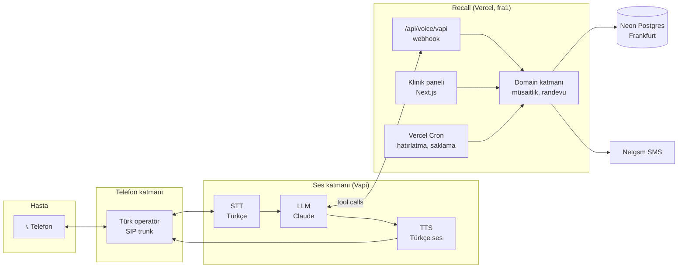

# Mimari

## Genel bakış



## Neden bu mimari?

**Gerçek zamanlı ses işleme Vercel'de çalışmaz.** Bir telefon görüşmesi dakikalarca açık kalan, çift yönlü ve düşük gecikmeli bir ses akışıdır. Vercel Functions ise istek-yanıt modeline göre çalışır. Bu yüzden sorumluluğu ikiye ayırıyoruz:

| Katman | Sorumluluk | Nerede |
|---|---|---|
| **Ses katmanı** | SIP, STT, LLM döngüsü, TTS, söz kesme (barge-in), sessizlik algılama | Vapi (yönetilen servis) |
| **İş katmanı** | Klinik config'i, müsaitlik, randevu, hasta, arama kaydı, panel | Recall / Vercel |

Ses katmanı iş katmanıyla iki yoldan konuşur:
1. **`assistant-request`:** Arama geldiğinde Vapi, aranan numarayı bize sorar. Biz o kliniğe özel asistan yapılandırmasını (prompt, ses, tool'lar) döneriz. **Tek bir kod tabanı, sınırsız klinik.**
2. **Tool çağrıları:** LLM bir işlem yapmak istediğinde (müsaitlik sorgulama, randevu oluşturma) Vapi webhook'umuzu çağırır. Biz domain katmanında işi yapıp sonucu döneriz.

Bu ayrım sayesinde ses sağlayıcısını değiştirmek (Retell, ElevenLabs Agents veya kendi LiveKit pipeline'ımız) sadece `src/server/voice/providers/` altında yeni bir adaptör yazmak anlamına gelir. Bkz. [ADR-002](../decisions/ADR-002-voice-platform.md).

## Bileşenler

### Next.js uygulaması (`src/app`)
- **`(marketing)`:** Herkese açık tanıtım sayfası.
- **`panel/`:** Oturum gerektiren klinik paneli. Server Components ve Server Actions.
- **`api/voice/vapi`:** Vapi server URL'i. Tek uç nokta, mesaj tipine göre dağıtım yapar.
- **`api/cron/*`:** Vercel Cron job'ları (hatırlatma SMS'leri, veri saklama temizliği).
- **`api/health`:** Uptime izleme.

### Sunucu katmanı (`src/server`)
- **`db/`:** Drizzle şeması, client, seed.
- **`domain/`:** Framework'ten bağımsız iş kuralları. Müsaitlik hesabı saf fonksiyondur ve DB'ye dokunmaz; tamamen birim test edilir.
- **`voice/`:**
  - `tools/`: Tool tanımları (Zod şema ve handler). Sağlayıcıdan bağımsızdır.
  - `prompt.ts`: Klinik config'inden system prompt üretir.
  - `providers/vapi/`: Vapi mesaj tipleri, imza doğrulama, asistan JSON'u.
- **`notifications/`:** SMS gönderimi (Netgsm adaptörü, lokalde konsol adaptörü).

### Veri
- **Postgres:** Tek veritabanı, satır seviyesinde kiracı izolasyonu (`clinic_id`). Bkz. [MULTI-TENANCY.md](MULTI-TENANCY.md).
- **Ses kayıtları:** Vapi'de tutulur; biz sadece URL saklarız. Saklama süresi: [DATA-RETENTION.md](../05-compliance/DATA-RETENTION.md).

## İstek akışları

### Gelen arama
Bkz. [USER-FLOWS.md §1](../00-product/USER-FLOWS.md#1-gelen-arama-yeni-randevu-ana-akış).

### Tool çağrısı (iç akış)
```
POST /api/voice/vapi
  → secret header doğrulaması
  → Zod ile mesaj parse
  → message.type === "tool-calls"
  → call.phoneNumber → clinic (çözümle, yoksa reddet)
  → her toolCall için: registry[name].input.parse(args) → handler(ctx, input)
  → { results: [{ toolCallId, result }] }
```
Tool handler'ları **her zaman** webhook'tan çözümlenen `clinicId` ile çalışır. LLM'in ürettiği argümanlar asla kiracı belirlemez.

## Gecikme bütçesi

Hedef: hasta konuşmayı bitirdikten sonra ilk sese kadar p50 < 1,0 sn.

| Aşama | Bütçe |
|---|---|
| Konuşma sonu algılama (endpointing) | 200–400 ms |
| STT final | 100–200 ms |
| LLM ilk token | 300–500 ms |
| Tool çağrısı (gerekirse) | < 300 ms |
| TTS ilk ses | 100–200 ms |

Tool webhook'u bu bütçenin bir parçasıdır: Vercel bölgesi (`fra1`) ve Neon bölgesi (`eu-central-1`) aynı yerde olmalı, sorgular indeksli olmalı. Ayrıntılar: [AGENT-DESIGN.md](../02-voice-agent/AGENT-DESIGN.md).

## Ortamlar

| Ortam | Uygulama | Veritabanı | Ses |
|---|---|---|---|
| Lokal | `pnpm dev` | Docker Postgres | Vapi + ngrok/cloudflared tüneli |
| Preview | Vercel Preview (her PR) | Neon dalı (PR başına) | Test numarası |
| Production | Vercel Production | Neon main | Gerçek klinik numaraları |
