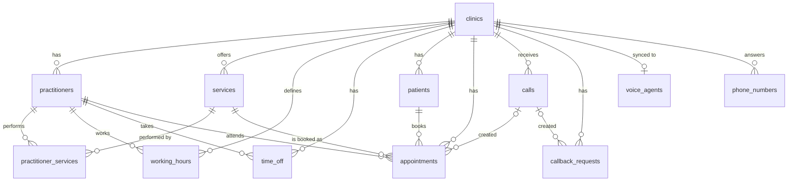

# Veri Modeli

Kaynak gerçek: [`src/server/db/schema.ts`](../../src/server/db/schema.ts). Bu belge kavramsal modeli ve kuralları açıklar.

## ER diyagramı



## Tablolar

### `clinics`: kiracı

| Kolon                  | Tip                    | Not                                                                                         |
| ---------------------- | ---------------------- | ------------------------------------------------------------------------------------------- |
| id                     | uuid PK                |                                                                                             |
| slug                   | text unique            | URL'lerde                                                                                   |
| name                   | text                   | Asistanın söylediği ad                                                                      |
| timezone               | text                   | Varsayılan `Europe/Istanbul`                                                                |
| transfer_phone_number  | text, null             | İnsana devretme numarası                                                                    |
| address                | text, null             |                                                                                             |
| settings               | jsonb                  | Asistan ayarları, bkz. [CLINIC-CONFIG-SCHEMA.md](../02-voice-agent/CLINIC-CONFIG-SCHEMA.md) |
| status                 | enum `active`/`paused` | `paused` iken asistan sadece mesaj bırakır                                                  |
| created_at, updated_at | timestamptz            |                                                                                             |

> Faz 2'de Better Auth `organization` tablosu eklenecek ve `clinics.organization_id` ile 1:1 bağlanacak.

### `voice_agents`: kliniğin Retell ajanı

| Kolon                              | Not                                                                                           |
| ---------------------------------- | --------------------------------------------------------------------------------------------- |
| clinic_id                          | unique: klinik başına bir ajan                                                                |
| provider                           | `retell`                                                                                      |
| external_agent_id, external_llm_id | Retell'deki kimlikler. Gelen tool ve olay çağrılarında kiracı `external_agent_id` ile bulunur |
| agent_version                      | Aramaların sabitlendiği sürüm (inbound webhook `override_agent_version`)                      |
| spec_hash                          | Son gönderilen tanımın özeti; değişmediyse senkron atlanır                                    |
| status, last_error, synced_at      | `pending` / `synced` / `error`; hata metni hasta verisi içermez                               |

### `phone_numbers`: gelen arama numaraları

| Kolon     | Not                                         |
| --------- | ------------------------------------------- |
| e164      | unique. Gelen aramada kiracıyı bu belirler  |
| clinic_id | Bir kliniğin birden fazla numarası olabilir |
| provider  | `retell`                                    |
| carrier   | `netgsm`, `verimor` … (F2)                  |
| is_active | Pasif numaraya gelen arama reddedilir       |

### `practitioners`: hekim veya uzman

`id, clinic_id, name, title (Dt., Dr., Uzm.), is_active`

### `services`: hizmet

| Kolon                | Not                                                                              |
| -------------------- | -------------------------------------------------------------------------------- |
| name                 | "Diş Taşı Temizliği"                                                             |
| aliases              | text[]: sesli eşleştirme için eş anlamlılar ("temizlik", "detertraj")            |
| duration_minutes     | Slot uzunluğu                                                                    |
| price_min, price_max | Kuruş (integer), null olabilir. `settings.assistant.speakPrices` açıksa söylenir |
| is_active            |                                                                                  |

### `practitioner_services`

Hangi hekim hangi hizmeti veriyor. Bir hizmet için hiç kayıt yoksa **tüm aktif hekimler** o hizmeti verebilir kabul edilir.

### `working_hours`: haftalık program

| Kolon                | Not                                 |
| -------------------- | ----------------------------------- |
| practitioner_id      | null ise **klinik açılış saatleri** |
| weekday              | 1 = Pazartesi … 7 = Pazar (ISO)     |
| start_time, end_time | `time`, kliniğin yerel saati        |

Bir güne birden fazla satır girilebilir (öğle arası = iki blok). Bir hekimin müsaitliği, **hekim saatleri ∩ klinik saatleri** olarak hesaplanır.

### `time_off`: izin ve tatil

`practitioner_id` null ise klinik tamamen kapalıdır (resmî tatil vb.). `starts_at, ends_at` timestamptz.

### `patients`

| Kolon          | Not                                                |
| -------------- | -------------------------------------------------- |
| full_name      |                                                    |
| phone          | E.164. `(clinic_id, phone)` unique                 |
| notes          | Panelden                                           |
| kvkk_notice_at | Aydınlatma anonsunun dinletildiği ilk arama zamanı |

### `appointments`

| Kolon                                   | Not                                                           |
| --------------------------------------- | ------------------------------------------------------------- |
| patient_id, practitioner_id, service_id |                                                               |
| starts_at, ends_at                      | timestamptz (UTC)                                             |
| status                                  | `scheduled`, `confirmed`, `cancelled`, `completed`, `no_show` |
| source                                  | `voice`, `panel`                                              |
| call_id                                 | Sesli asistan oluşturduysa                                    |
| notes, cancelled_at                     |                                                               |

**Çifte rezervasyon engeli:** Aynı hekim için aktif (`scheduled`, `confirmed`) randevuların zaman aralıkları çakışamaz. Bu kural PostgreSQL `EXCLUDE USING gist` constraint'i ile **veritabanında** zorlanır, sadece uygulama kodunda değil. İki arama aynı anda aynı slotu almaya çalışırsa biri hata alır ve asistan yeni slot önerir.

### `calls`

| Kolon                                  | Not                                                                                                          |
| -------------------------------------- | ------------------------------------------------------------------------------------------------------------ |
| provider, provider_call_id             | `retell`, unique                                                                                             |
| from_number, to_number                 |                                                                                                              |
| started_at, ended_at, duration_seconds |                                                                                                              |
| ended_reason                           | Sağlayıcıdan gelen                                                                                           |
| outcome                                | `booked`, `cancelled`, `rescheduled`, `info`, `transferred`, `callback`, `abandoned`, `other`                |
| summary, transcript                    | Hassas veri, saklama politikasına tabi                                                                       |
| recording_url                          |                                                                                                              |
| cost_usd                               | numeric                                                                                                      |
| flags, flagged_at                      | Arama sonrası işaretler (`POST_CALL_FLAGS`)                                                                  |
| latency                                | jsonb, uçtan uca/ASR/LLM/TTS için p50, p90, max (ms); yalnızca `CALL_LATENCY_STORE` açıkken (migration 0020) |

### `callback_requests`: geri aranacaklar

`clinic_id, call_id, patient_name, phone, reason, status (open/done), resolved_at`

### `call_patients`: aramanın hangi hastalarla ilgili olduğu (2026-10-08)

`clinic_id, call_id, patient_id` (birincil anahtar `call_id, patient_id`; bileşik kiracı FK'leri). Asistan bir aramada hastanın randevusunu oluşturduğunda, bulduğunda, iptal ettiğinde veya taşıdığında yazılır. KVKK silmesi bu bağları izler (gizli numara ve başkasının numarası dahil). Migration 0015, mevcut randevuların `call_id` alanından doldurur.

### `provider_deletions`: sağlayıcı tarafı silme kuyruğu (2026-10-08)

`clinic_id, provider, provider_call_id (benzersiz), reason (patient_anonymized/recording_off), attempts, last_error, next_attempt_at, done_at`. Kişisel veri içermez; `done_at` silmenin kaydıdır.

## Kurallar

- Her tabloda (clinics hariç) `clinic_id NOT NULL` ve `ON DELETE CASCADE` var.
- Para birimi kuruş (integer). Float kullanılmaz.
- Telefon numaraları E.164 (`+905321234567`) olarak normalize edilir: `src/lib/phone.ts`.
- Silme: hasta silme talebi (KVKK) gelirse hasta anonimleştirilir, randevu istatistikleri korunur. Bkz. [DATA-RETENTION.md](../05-compliance/DATA-RETENTION.md).

## Migration

```bash
pnpm db:generate   # schema.ts değişikliğinden SQL migration üret
pnpm db:migrate    # uygula
```

Exclusion constraint gibi Drizzle'ın ifade edemediği yapılar, `drizzle/` altındaki **custom** migration dosyalarında düz SQL olarak tutulur.
