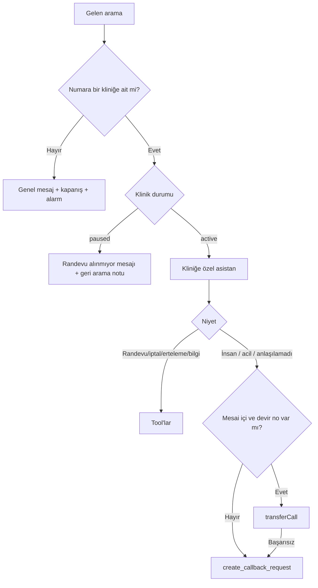

# Çağrı Yönlendirme

## Yönlendirme modları (klinik seçer)

| Mod                   | Ne zaman Recall'a gider                 | Kimin için                          |
| --------------------- | --------------------------------------- | ----------------------------------- |
| **Her zaman**         | Tüm aramalar                            | Sekreteri olmayan veya yoğun klinik |
| **Meşgul / cevapsız** | Sekreter meşgulse veya X saniye açmazsa | Sekreteri olan klinik (en yaygın)   |
| **Mesai dışı**        | Klinik kapalıyken                       | Başlangıç için düşük riskli seçenek |

Yönlendirme kliniğin **kendi operatöründe** (veya santralinde) kurulur. Recall ekibi onboarding sırasında adım adım yardım eder ([ONBOARDING.md](../04-panel/ONBOARDING.md)).

## Recall içinde akış

## Devir (transfer)

- Hedef: `clinics.transfer_phone_number`.
- **Döngü riski:** Klinik "meşgul/cevapsız → Recall" yönlendirmesi kullanıyorsa ve devir numarası aynı numaraysa arama tekrar Recall'a döner. Bu yüzden devir numarası **farklı bir hat** olmalıdır (sekreterin cep telefonu, dahili hat). Onboarding'de kontrol edilir.
- Devir modu: Retell `transfer_call` (cold transfer). Asistan devretmeden önce kısa bir bilgilendirme yapar ("Sizi arkadaşıma aktarıyorum").

## Yoğunluk

- Retell eşzamanlı arama limiti hesap planına bağlıdır. Klinik başına eşzamanlı arama limiti (ör. 3) `settings` ile sınırlandırılabilir (Faz 3).
- SIP trunk kanal sayısı operatör sözleşmesinde belirlenir.
