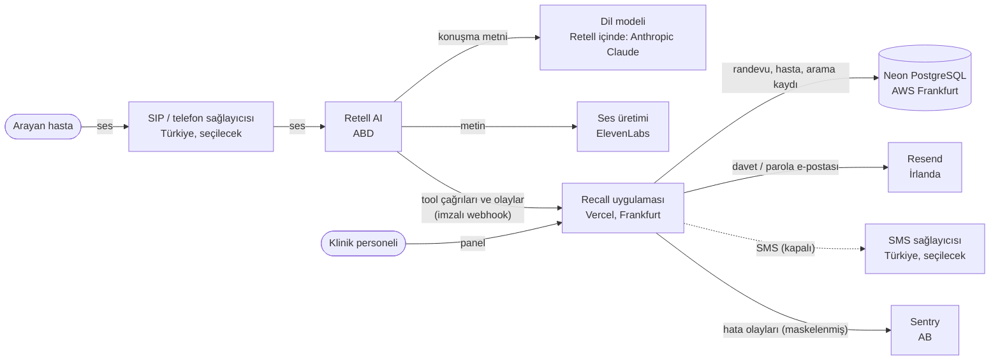

# Veri akışı ve alt işleyenler

> **DRAFT, not reviewed by a lawyer.** TASLAK — avukat incelemesinden geçmedi.

_2026-10-09, güncelleme 2026-10-19. Bölgeler bugünkü yapılandırmaya göredir ([DEPLOYMENT.md](../06-operations/DEPLOYMENT.md)); SIP ve SMS için Netgsm yönünde karar verildi, başvuru yapılmadı. Uptime izleme (UptimeRobot) yalnızca herkese açık sağlık adreslerine bakar, kişisel veri işlemez._

## Veri akışı

## Alt işleyenler

| Sağlayıcı                                     | Ne işler                                                                         | Konum                                   | Saklama                                                         | Not                                                        |
| --------------------------------------------- | -------------------------------------------------------------------------------- | --------------------------------------- | --------------------------------------------------------------- | ---------------------------------------------------------- |
| Retell AI                                     | Ses, döküm, arama kaydı, çağrı meta verisi                                       | ABD                                     | 30 gün (ajan ayarı); "kayıt kapalı" ise analizden sonra silinir | Yurt dışı aktarım (m.9)                                    |
| Retell içindeki dil modeli (Anthropic Claude) | Konuşma metni                                                                    | ABD                                     | Sağlayıcı koşulları → **doğrulanmadı**                          | Retell üzerinden                                           |
| ElevenLabs                                    | Asistanın söyleyeceği metin                                                      | ABD/AB → **doğrulanmadı**               | Sağlayıcı koşulları → **doğrulanmadı**                          | Retell üzerinden                                           |
| Retell'in konuşma tanıma sağlayıcısı          | Arayanın sesi                                                                    | → **doğrulanmadı**                      | → **doğrulanmadı**                                              | Retell'e sorulacak                                         |
| Vercel                                        | Uygulama sunucusu, loglar (kişisel veri yazılmaz)                                | AB (Frankfurt bölgesi), şirket ABD      | Log saklama plana göre                                          |                                                            |
| Neon                                          | Veritabanı (tüm klinik verisi)                                                   | AWS eu-central-1 (Frankfurt)            | Klinik verisi + 6 saat (Free) / 7 gün (Launch) geçmiş           |                                                            |
| Resend                                        | Personel e-posta adresi, davet/parola bağlantısı                                 | AB (İrlanda)                            | Sağlayıcı koşulları                                             | Hasta verisi yok                                           |
| Sentry                                        | Hata olayları (telefon/e-posta maskelenmiş, kullanıcı ve istek gövdesi silinmiş) | AB (ürün sahibi teyit etti, 2026-10-19) | Sağlayıcı koşulları                                             | Canlıda açık (2026-10-19)                                  |
| SIP / telefon sağlayıcısı (seçilecek)         | Ses (geçiş), arayan numarası, çağrı kaydı                                        | Türkiye                                 | Sağlayıcı koşulları → **sorulacak**                             | [PHONE-LINE-OPTIONS.md](../07-sales/PHONE-LINE-OPTIONS.md) |
| SMS sağlayıcısı (seçilecek, kapalı)           | Telefon, mesaj metni                                                             | Türkiye                                 | Sağlayıcı koşulları                                             | İYS                                                        |
| GitHub                                        | Kaynak kodu (hasta verisi yok)                                                   | ABD                                     | —                                                               | Özel depo                                                  |

## Veri kategorileri

| Kategori                | Örnek                                       | Nerede                       |
| ----------------------- | ------------------------------------------- | ---------------------------- |
| Kimlik / iletişim       | Ad soyad, telefon                           | Veritabanı, Retell (görüşme) |
| Sağlık (özel nitelikli) | Hizmet adı, şikâyet, takip planı            | Veritabanı, döküm, Retell    |
| Ses kaydı               | Görüşme                                     | Retell (30 gün)              |
| İşlem güvenliği         | Denetim kaydı (kimlikler, kişisel veri yok) | Veritabanı                   |
| Personel                | Ad, e-posta, rol                            | Veritabanı, Resend           |
